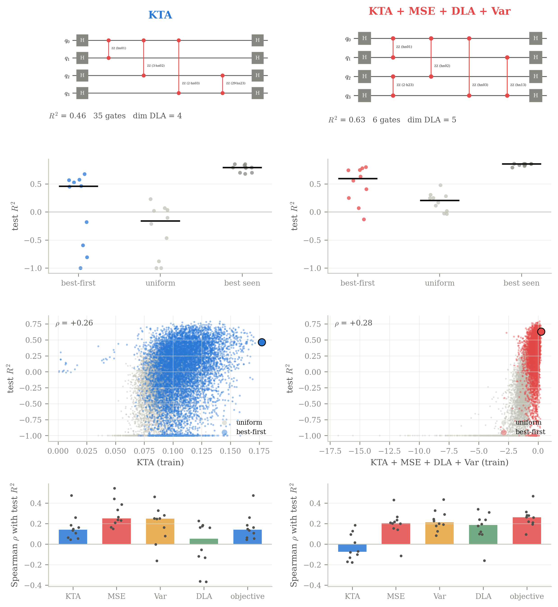
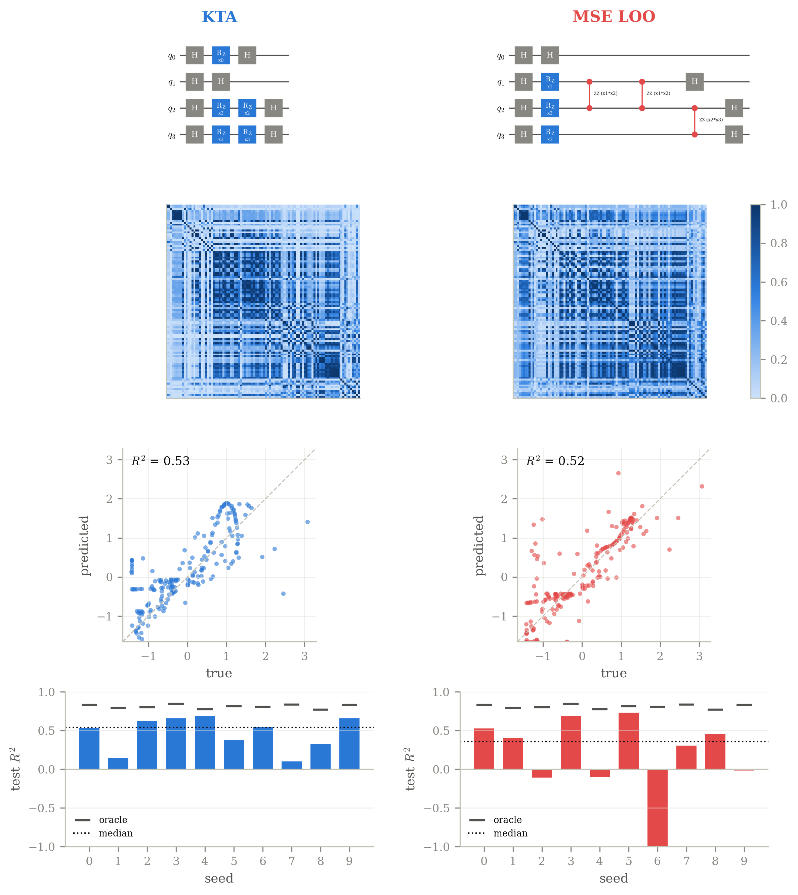
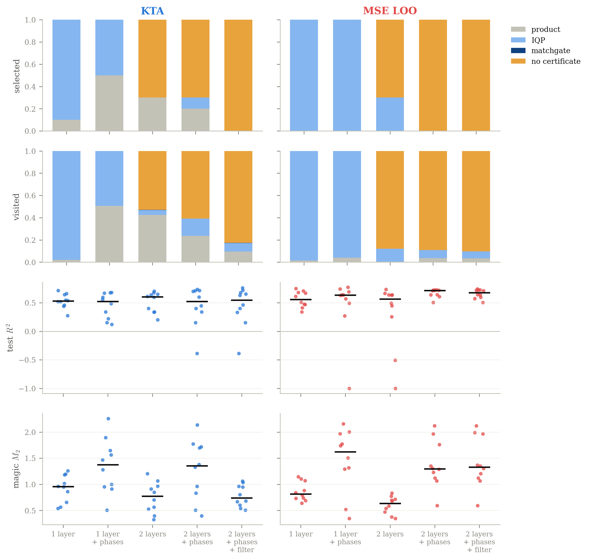

# qksearch : recherche automatique de feature maps pour noyaux quantiques

[](https://github.com/yanihaouchine/qksearch/actions/workflows/ci.yml)

[](LICENSE)

*[English version](README.md)*

Un noyau quantique vaut ce que vaut sa *feature map*, le circuit qui encode
une donnée dans un état quantique, et ce circuit est le plus souvent dessiné à
la main. **qksearch en fait une recherche combinatoire** : il construit des
circuits IQP porte par porte et classe les candidats avec des heuristiques
calculées sur la seule matrice de Gram, sans entraîner de modèle par circuit.
L'application visée est la prédiction de l'adsorption d'hydrogène dans des MOF
(*metal-organic frameworks*) à partir de quatre descripteurs physiques.

Stage de recherche, Prasad Research Group, Université de Calgary (été 2026).

## Résultats

Tous les chiffres sont des médianes sur 10 découpages train/test aléatoires
des données MOF (100 points d'entraînement, 4 qubits). Chaque figure se
régénère avec la commande indiquée.

### Un objectif composite trouve des circuits meilleurs et plus petits (E17)

<p align="center"></p>

Recherche best-first dans un espace de 3,4 × 10¹⁶ circuits (jusqu'à 40
portes), avec 8 000 évaluations. En optimisant seul l'alignement noyau-cible
(KTA), le choix standard, on obtient des circuits de 22 portes et un R² test
de 0,46. La somme de quatre signaux peu coûteux (KTA, erreur leave-one-out de
la ridge en forme close, variance du Gram, dimension de l'algèbre de Lie)
donne **des circuits de 7 portes et un R² test de 0,60**. La recherche compte
aussi : un tirage uniforme de même budget plafonne à 0,21.

`python -m experiments 17`

### Mieux classer ne veut pas dire mieux choisir (E16)

Évaluation exhaustive des 8 008 circuits à 6 portes. L'erreur leave-one-out
de la ridge classe les circuits **deux fois mieux** que le KTA (ρ de Spearman
avec le R² test : 0,52 contre 0,26), mais son meilleur choix généralise moins
bien (R² test 0,35 contre 0,54) : un argmax sur des milliers de candidats
exploite le bruit de toute estimation faite sur l'entraînement. À 10 portes
(184 756 circuits), l'écart se creuse (−0,46 contre 0,27). C'est pourquoi
E17 combine les signaux au lieu de passer au mieux classant.

<details><summary>Figure</summary>
<p align="center"></p>
</details>

`python -m experiments 16`

### Les noyaux retenus sont-ils simulables classiquement ? (E18)

`qksearch.simulability` certifie qu'un noyau se calcule classiquement (états
produits, blocs IQP par échantillonnage, matchgates à fermions libres) et
ajoute un test empirique : des random Fourier features tirées dans le spectre
de fréquences du circuit lui-même. Avec une couche IQP, **tous** les circuits
retenus sont certifiés. Avec deux couches, les certificats structurels tombent
à 0–30 %, mais le modèle à features aléatoires égale ou bat le noyau quantique
sur 50 à 70 % des découpages. À cette échelle, la recherche ne trouve pas de
noyau clairement hors de portée du classique.

<details><summary>Figure</summary>
<p align="center"></p>
</details>

`python -m experiments 18`

### Résultats négatifs

Plusieurs des enseignements les plus utiles sont négatifs ; ils sont détaillés
avec les 15 expériences précédentes dans
[`docs/experiments.md`](docs/experiments.md) (en anglais) :

- Pousser le KTA plus loin n'aide pas : un algorithme génétique retrouve
  l'optimum exact du KTA sur le petit espace, mais dans un espace à deux
  couches il fait encore monter le KTA pendant que le R² test baisse (E11).
- MCTS passe sous le tirage uniforme dès 6 qubits, alors que le contraste du
  noyau et le budget de shots tiennent jusqu'à 8 qubits (E15). Le score étant
  exact à chaque nœud, les rollouts aléatoires de MCTS n'apportent rien que la
  recherche best-first n'exploite déjà.
- Le KTA continue de monter avec la bande passante de l'encodage après le pic
  du R² test (E13) : la bande passante pèse autant que la structure du
  circuit, et le KTA ne sait pas la régler.

## Démarrage rapide

```bash
git clone https://github.com/yanihaouchine/qksearch && cd qksearch
pip install -e ".[dev]"
python examples/quickstart.py
```

où `train` est un `RegressionDataset` de features converties en angles
(voir [`examples/quickstart.py`](examples/quickstart.py)) :

```python
from qksearch import BestFirstSearch, NumpyBackend, RidgeLooMse, build_heuristic, search

heuristic = build_heuristic(train, n_qubits=2, n_data_gates=6,
                            backend=NumpyBackend(2), metric=RidgeLooMse())
result = search((), heuristic, BestFirstSearch(), budget=200)
```

```bash
pytest                                     # 126 tests, environ une minute
python -m experiments 17 --plot-only       # redessiner une figure depuis results/
```

## Fonctionnement

Un circuit est un tuple de portes `(nom, qubits, features)`. Les circuits IQP
s'écrivent `H D(x) H` avec `D` diagonale, donc leurs portes commutent : un
circuit est un multiensemble, et le jeu de portes n'ajoute les portes que
dans un ordre canonique pour visiter chaque multiensemble une seule fois. Les
stratégies de recherche ne voient qu'un protocole générique `Heuristic`
(candidats, extension, score), ce qui les rend indépendantes du quantique.
L'évaluation est rapide car le backend NumPy simule tous les échantillons à
la fois, les portes diagonales se réduisent à des phases terme à terme, et un
circuit enfant réutilise les vecteurs d'état mis en cache de son parent.

| Module | Rôle |
| --- | --- |
| [`gates`](qksearch/gates.py) | vocabulaire de portes, jeux de portes canoniques et en couches |
| [`kernel`](qksearch/kernel.py) | matrices de Gram incrémentales et par lots ; l'`Heuristic` de recherche |
| [`metric`](qksearch/metric/) | KTA, alignement centré, LOO ridge en forme close, sommes pondérées |
| [`search`](qksearch/search/) | glouton, best-first, backtracking, MCTS, probabiliste, génétique |
| [`backend`](qksearch/backend/) | simulateur NumPy vectorisé ; références Qiskit et PennyLane |
| [`dla`](qksearch/dla.py) | dimension de l'algèbre de Lie dynamique par clôture de Pauli |
| [`simulability`](qksearch/simulability.py) | certificats de simulabilité classique, random Fourier features |
| [`genome`](qksearch/genome.py) | encodage entier de longueur fixe pour l'algorithme génétique |

`experiments/` contient un script par expérience (E1–E18), `tests/` les tests
unitaires et des vérifications de bout en bout plus lentes.

## Reproductibilité

`requirements.txt` épingle les versions utilisées pour les résultats ; avec
elles, les figures se régénèrent au pixel près. Chaque expérience est
initialisée par une graine fixe, écrit ses résultats bruts dans `results/` et consigne ses
paramètres, sa durée et son commit git dans `results/meta.json`.

## Références

- V. Havlíček et al., *Supervised learning with quantum-enhanced feature spaces*, Nature 567 (2019).
- N. Cristianini et al., *On kernel-target alignment*, NeurIPS (2001).
- M. Bremner, R. Jozsa, D. Shepherd, *Classical simulation of commuting quantum computations implies collapse of the polynomial hierarchy*, Proc. R. Soc. A (2011).
- H.-Y. Huang et al., *Power of data in quantum machine learning*, Nature Communications 12 (2021).
- A. Rahimi, B. Recht, *Random features for large-scale kernel machines*, NeurIPS (2007).

## Licence

[MIT](LICENSE)
