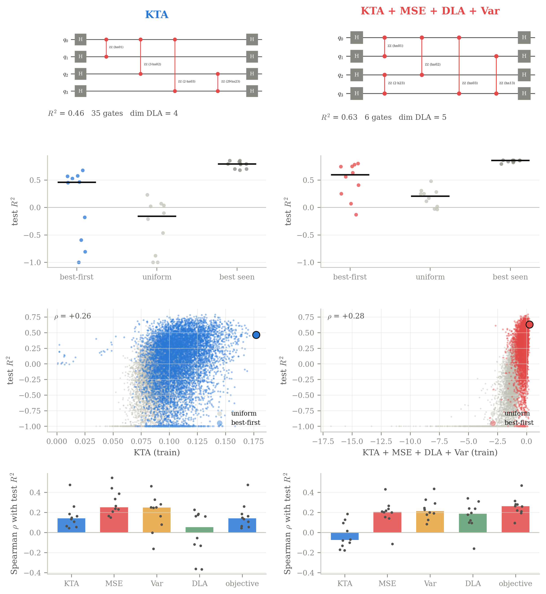
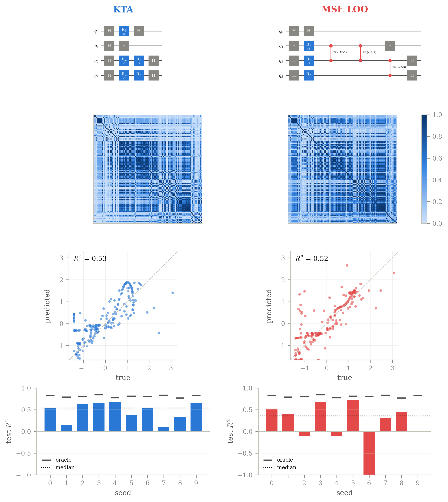
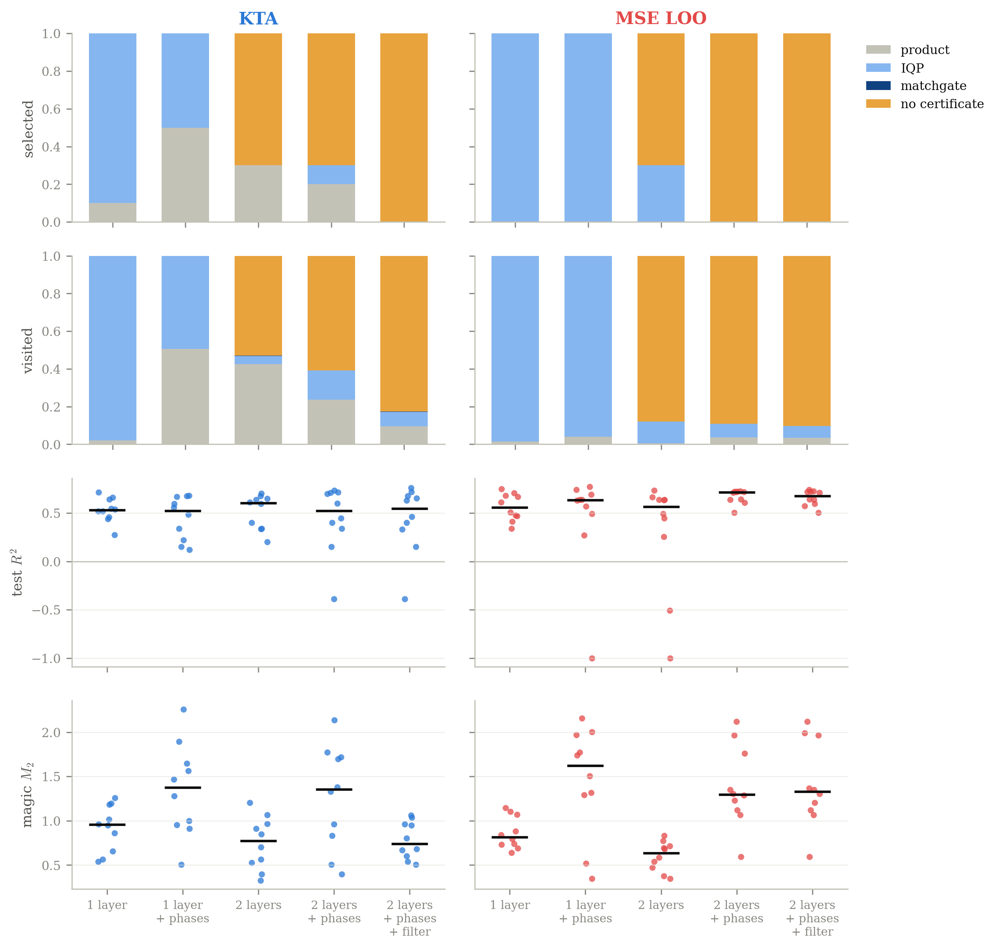

# qksearch: searching for quantum-kernel feature maps

[](https://github.com/yanihaouchine/qksearch/actions/workflows/ci.yml)

[](LICENSE)

*[Version française](README.fr.md)*

A quantum kernel is only as good as its feature map, the circuit that encodes
a data point into a quantum state, and that circuit is usually designed by
hand. **qksearch treats the design as a combinatorial search**: it grows IQP
circuits gate by gate and ranks the candidates with heuristics computed from
the Gram matrix alone, without training a model per circuit. The target
application is predicting hydrogen uptake in metal-organic frameworks (MOF)
from four physical descriptors.

Research internship, Prasad Research Group, University of Calgary (summer 2026).

## Results

All numbers are medians over 10 random train/test splits of the MOF data
(100 training points, 4 qubits). Each figure is regenerated by the command
under it.

### A composite objective finds better and smaller circuits (E17)

<p align="center"></p>

Best-first search over a space of 3.4 × 10¹⁶ circuits (up to 40 gates), with
8 000 evaluations. Optimizing the kernel-target alignment (KTA) alone, the
standard choice, selects 22-gate circuits with test R² = 0.46. Summing four
cheap signals (KTA, closed-form leave-one-out ridge error, Gram variance and
Lie-algebra dimension) selects **7-gate circuits with test R² = 0.60**. The
search matters too: uniform sampling with the same budget reaches only 0.21.

`python -m experiments 17`

### Better ranking does not mean a better pick (E16)

Exhaustive scoring of all 8 008 circuits with 6 data gates. The leave-one-out
ridge error ranks circuits **twice as well** as the KTA (Spearman ρ with test
R²: 0.52 against 0.26), yet its top choice generalizes worse (test R² 0.35
against 0.54): an argmax over thousands of candidates exploits the noise of
any training-set estimate. With 10 gates (184 756 circuits) the gap widens
(−0.46 against 0.27). This is why E17 combines signals instead of switching
to the best-ranking one.

<details><summary>Figure</summary>
<p align="center"></p>
</details>

`python -m experiments 16`

### Are the selected kernels classically simulable? (E18)

`qksearch.simulability` certifies that a circuit's kernel can be computed
classically (product states, IQP blocks by sampling, free-fermion matchgates),
and adds an empirical test: random Fourier features drawn from the circuit's
own frequency spectrum. With one IQP layer, **every** selected circuit is
certified. With two layers, structural certificates drop to 0–30 %, but the
random-feature model matches or beats the quantum kernel on 50–70 % of the
splits. The search does not find kernels that are clearly out of classical
reach at this scale.

<details><summary>Figure</summary>
<p align="center"></p>
</details>

`python -m experiments 18`

### Negative results

Some of the most useful findings were negative; they are documented in
[`docs/experiments.md`](docs/experiments.md) with the 15 earlier experiments:

- Maximizing the KTA harder does not help: a genetic algorithm recovers the
  exact KTA optimum of the small space, but in a larger two-layer space it
  raises the KTA further while the test R² drops (E11).
- MCTS falls below uniform random sampling from 6 qubits on, while the kernel
  contrast and the shot budget still hold up to 8 qubits (E15). The scores are
  exact at every node, so the random rollouts of MCTS bring nothing that
  best-first search does not already exploit.
- The KTA keeps rising with the encoding bandwidth after the test R² has
  peaked (E13): the bandwidth matters as much as the circuit structure, and
  the KTA cannot tune it.

## Quickstart

```bash
git clone https://github.com/yanihaouchine/qksearch && cd qksearch
pip install -e ".[dev]"
python examples/quickstart.py
```

where `train` is a `RegressionDataset` of angle-scaled features (see
[`examples/quickstart.py`](examples/quickstart.py)):

```python
from qksearch import BestFirstSearch, NumpyBackend, RidgeLooMse, build_heuristic, search

heuristic = build_heuristic(train, n_qubits=2, n_data_gates=6,
                            backend=NumpyBackend(2), metric=RidgeLooMse())
result = search((), heuristic, BestFirstSearch(), budget=200)
```

```bash
pytest                                     # 126 tests, about a minute
python -m experiments 17 --plot-only       # redraw a figure from results/
```

## How it works

A circuit is a tuple of gates `(name, qubits, features)`. IQP circuits are
`H D(x) H` with a diagonal `D`, so their gates commute: a circuit is a
multiset, and the gate set only appends gates in a canonical order to visit
each multiset once. Search strategies only see a generic `Heuristic` protocol
(candidates, extend, score), which keeps them independent of quantum details.
Scoring is fast because the NumPy backend simulates all samples at once,
diagonal gates are element-wise phases, and a child circuit reuses its
parent's cached statevectors.

| Module | Role |
| --- | --- |
| [`gates`](qksearch/gates.py) | gate vocabulary, canonical gate sets, layered IQP gate sets |
| [`kernel`](qksearch/kernel.py) | incremental, batched Gram matrices; the search `Heuristic` |
| [`metric`](qksearch/metric/) | KTA, centered alignment, closed-form LOO ridge, weighted sums |
| [`search`](qksearch/search/) | greedy, best-first, backtracking, MCTS, probabilistic, genetic |
| [`backend`](qksearch/backend/) | vectorized NumPy simulator; Qiskit and PennyLane references |
| [`dla`](qksearch/dla.py) | dynamical Lie algebra dimension via Pauli closure |
| [`simulability`](qksearch/simulability.py) | classical-simulability certificates, random Fourier features |
| [`genome`](qksearch/genome.py) | fixed-length integer encoding of circuits for the genetic algorithm |

`experiments/` holds one script per experiment (E1–E18), `tests/` the unit
tests and slower end-to-end checks.

## Reproducibility

`requirements.txt` pins the versions used for the results; with them, the
figures are regenerated pixel for pixel. Every experiment is seeded, writes
its raw results to `results/`, and logs its parameters, wall time and git
commit to `results/meta.json`.

## References

- V. Havlíček et al., *Supervised learning with quantum-enhanced feature spaces*, Nature 567 (2019).
- N. Cristianini et al., *On kernel-target alignment*, NeurIPS (2001).
- M. Bremner, R. Jozsa, D. Shepherd, *Classical simulation of commuting quantum computations implies collapse of the polynomial hierarchy*, Proc. R. Soc. A (2011).
- H.-Y. Huang et al., *Power of data in quantum machine learning*, Nature Communications 12 (2021).
- A. Rahimi, B. Recht, *Random features for large-scale kernel machines*, NeurIPS (2007).

## License

[MIT](LICENSE)
